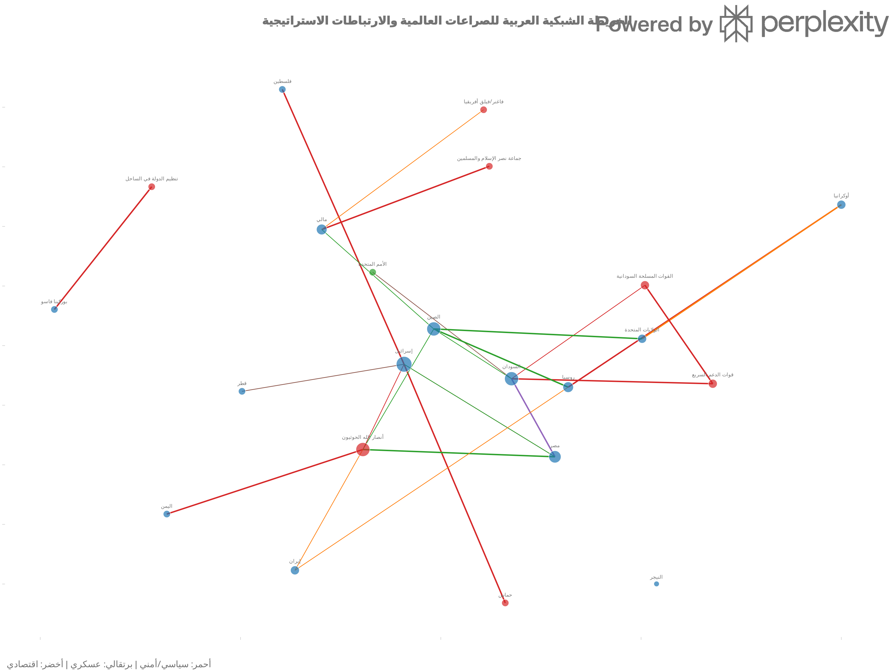

# المبادرة البحثية لرسم خريطة الارتباطات العالمية للصراعات وتصميم استراتيجيات فك الارتباطات

## نظرة عامة

يقدم هذا المشروع خريطة شبكية عالمية للصراعات والارتباطات الاستراتيجية، مبنية على 20 صراعًا، و22 فاعلًا، و25 علاقة موثقة، و14 مصدرًا للأدلة. تم تصنيف الروابط إلى أربع فئات استراتيجية (A-D) وتصميم 24 سيناريو لفك الارتباطات وإعادة تشكيل العلاقات.

## فك الارتباط

فك الارتباط في هذا المشروع لا يعني قطع جميع العلاقات بين الدول أو الجهات، بل تقليل الاعتمادات التي تغذي الصراع أو تمنح طرفًا قدرة قسرية غير متوازنة، مع الحفاظ على الروابط التي تخدم السلام والاستقرار والاحتياجات الإنسانية. ويستند التصنيف إلى أربع فئات: روابط تصعيدية قابلة للتقليل، اعتمادات استراتيجية خطرة، روابط قابلة للتحويل إلى أدوات سلام، وروابط يجب الحفاظ عليها أو تقويتها.

تهدف استراتيجيات فك الارتباط إلى تقليل قدرة الأطراف على مواصلة العنف، دون خلق فراغ أمني أو أزمة إنسانية جديدة. ويشمل ذلك تنظيم تدفقات التسليح، وتنويع مصادر الطاقة والتجارة، وحماية الممرات الحيوية، وتوسيع الوساطة، وبناء بدائل اقتصادية وإنسانية مستدامة. وترتبط كل توصية بمؤشرات نجاح قابلة للقياس وآليات مراجعة دورية.

## لقطات من الخريطة

يمكن استكشاف النسخة التفاعلية عبر فتح ملف `conflict_network_ar.html` في المتصفح.

## كيف تشارك؟

نرحب بالباحثين والناشطين والمتخصصين في:

- دراسات السلام والنزاعات
- العلاقات الدولية والتحالفات
- تحليل الشبكات وعلوم البيانات
- الاقتصاد السياسي والطاقة
- القانون الدولي والدبلوماسية
- الذكاء الاصطناعي والاستشراف الاستراتيجي

يمكنك المساهمة عبر:

- مراجعة العلاقات والبيانات
- اقتراح مصادر أو دراسات
- تحليل منطقة أو ملف محدد
- تحسين الخريطة التفاعلية
- نشر المشروع أو تقديم ملاحظات

للمساهمة، افتح Issue في المستودع أو تواصل معنا عبر:  
**[alkurdihazem86@gmail.com]**

## الملفات

- `final_strategic_report.md`: التقرير الاستراتيجي الشامل
- `conflicts.csv`: سجل الصراعات (20 صراعًا)
- `actors.csv`: دليل الفاعلين (22 فاعلًا)
- `edges.csv`: قاعدة بيانات العلاقات (25 علاقة)
- `evidence.csv`: ملف المصادر (14 مصدرًا)
- `network_analysis.csv`: تحليل البنية الشبكية
- `interventions.csv`: مصفوفة فك الارتباطات (25 تدخلًا)
- `scenarios.csv`: السيناريوهات (24 سيناريو)
- `conflict_network_ar.html`: الخريطة الشبكية التفاعلية
- `conflict_network_ar.png`: الخريطة الثابتة عالية الدقة

## كيفية الاستخدام

- افتح `conflict_network_ar.html` في المتصفح لاستكشاف الشبكة تفاعليًا.
- راجع `final_strategic_report.md` للتفاصيل الكاملة.
- استخدم ملفات CSV للتحليل والتحديث.
